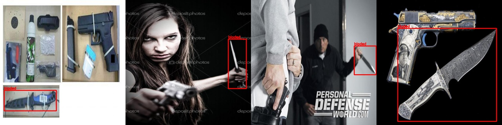

# Protocolo de anotación

Responde al Reviewer 1, punto 4 ("annotation guidelines, inter-annotator agreement,
examples of ambiguous or low-quality annotations").

## Qué se hizo en este trabajo

Las imágenes con armas **no se anotaron a mano**: se usaron las cajas de los datasets
públicos tal como venían. El trabajo de anotación propio fue:

1. **Unificar clases.** Todas las cajas pasan a dos clases, en formato YOLO
   (`clase cx cy w h`, normalizado a 0-1):

   | Clase | Id | Incluye |
   |---|---|---|
   | `arma_fuego` | 0 | Pistolas, revólveres, rifles, escopetas |
   | `arma_blanca` | 1 | Cuchillos, navajas, machetes |

2. **Remapear el dataset externo** (Dangerous Items, Zenodo), con revisión visual de
   muestras de cada clase antes de fijar el mapeo (`experimentos/remapear.py`):
   `gun`, `rifle` → `arma_fuego`; `knife`, `machete` → `arma_blanca`;
   `baseball bat` → se elimina la caja (no es una clase del sistema). Las imágenes que
   quedan sin cajas son ejemplos negativos.
3. **Imágenes sin armas** (etiqueta vacía, que en YOLO significa "no hay objetos"):
   - recortes de las propias imágenes del dataset que no tocan ninguna caja anotada,
     descartando los de baja varianza (fondos lisos);
   - 404 capturas de la cámara municipal de la calle, en horario de tránsito normal
     (`reentrenamiento/capturar_fondos.py`), para que el modelo vea motos, personas y
     vehículos sin armas. El script no registra una revisión manual una por una.

No se midió concordancia entre anotadores: no hubo anotadores propios para las cajas de
armas.

## Problemas de anotación conocidos

**Anotaciones incompletas.** En 4 imágenes de la fuente de pistolas (prefijo `armas`)
solo está anotado el cuchillo; la pistola visible en la misma imagen no tiene caja
(`anotaciones_incompletas.jpg`, generado con `experimentos/anotaciones_incompletas.py`).
Para el entrenamiento, esa pistola cuenta como fondo, lo que enseña al modelo a no
detectarla. Es el tipo de error que más afecta: una caja que falta penaliza una
detección correcta.

**Copias aumentadas repartidas entre train y val.** Roboflow exporta varias versiones de
cada foto con nombres distintos; al partir por archivo, 3 056 fotos originales quedaron
en los dos lados (ver `ESTADO_CORRECCIONES_FRONTIERS.md`, punto 8).

**Duplicados dentro del dataset externo.** 194 imágenes del test de Zenodo son copias de
su propio train/val; se excluyen de todas las métricas.

**Cajas con distinto criterio entre fuentes.** Algunas fuentes encierran solo la hoja del
cuchillo y otras el cuchillo con la mano; por eso una detección correcta puede contar
como error con IoU 0.5 (ver `docs/evidencia_externa/v5/`, caso
`localizacion_machete_caja_desplazada.jpg`).

## Guía para anotaciones nuevas

Para ampliar el dataset (por ejemplo, con video de las cámaras propias):

1. **Una caja por arma visible**, ajustada a la parte visible del arma, sin incluir la
   mano salvo la parte que tapa el arma. Si en la imagen hay varias armas, se anotan
   **todas**: una sin caja enseña al modelo a ignorarla.
2. **Armas parcialmente ocultas** (en la mano, en el bolsillo) se anotan si se reconoce
   el arma; si solo se ve la empuñadura o la funda, no se anotan.
3. **Fuera del sistema:** bates, palos, herramientas y armas de juguete evidentes no se
   anotan; la imagen queda como negativa.
4. **Tamaño mínimo:** no anotar armas de menos de 10 × 10 píxeles a la resolución
   original; no se pueden detectar a 640 px y solo agregan ruido.
5. **Partición por foto original o por video**, nunca por archivo: todas las copias,
   aumentos o fotogramas de una misma escena van al mismo lado.
6. **Revisión cruzada:** una segunda persona revisa al menos un 10 % de las imágenes
   anotadas; se reporta el acuerdo (IoU medio de las cajas y porcentaje de cajas
   faltantes o sobrantes).
